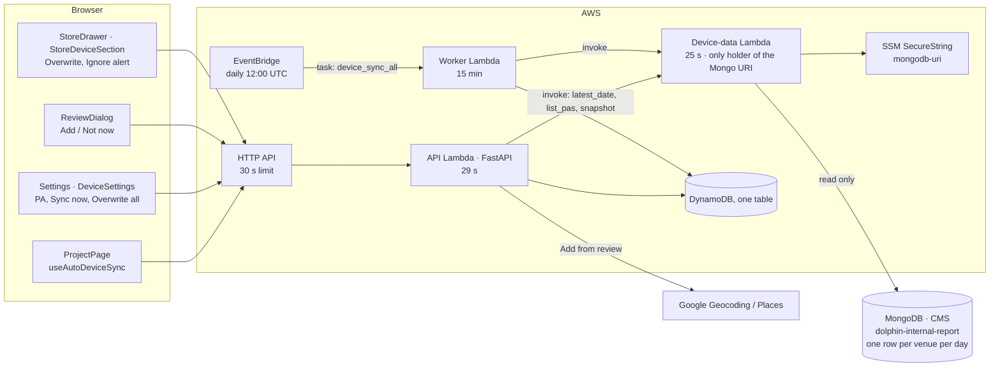
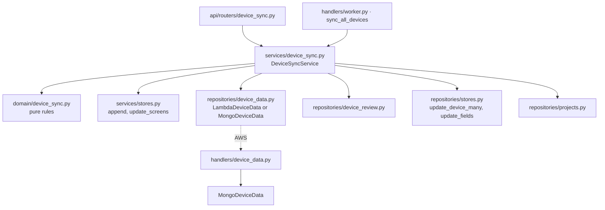
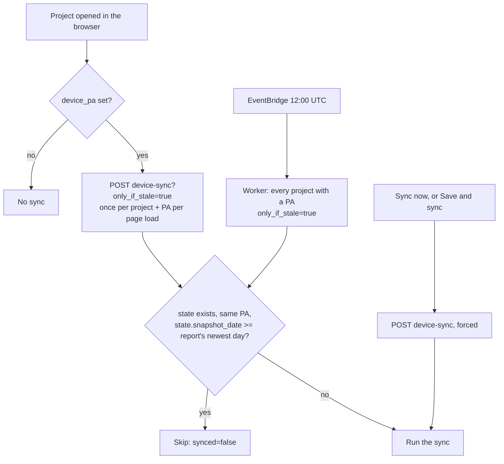
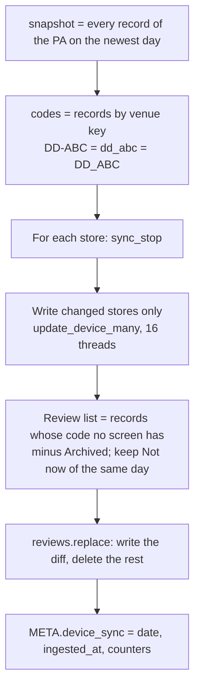
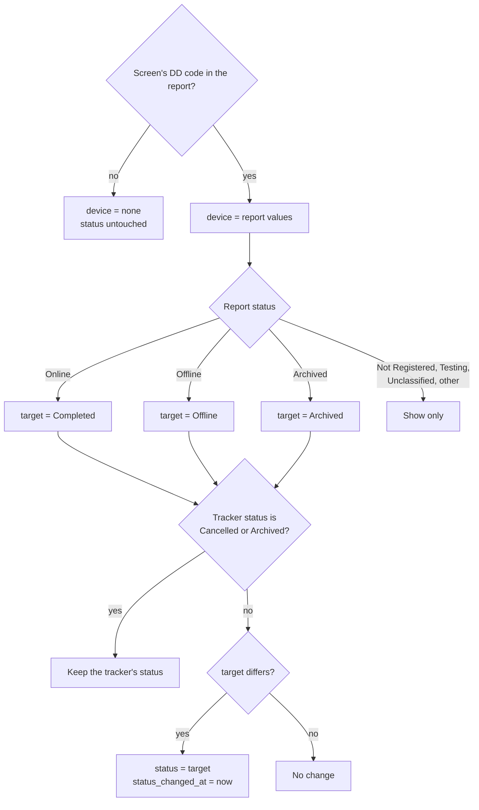
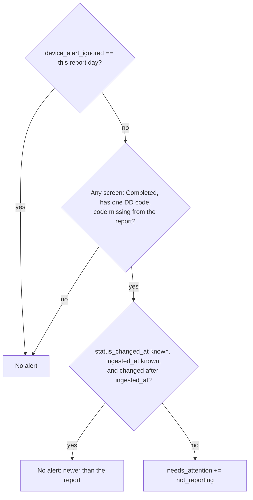
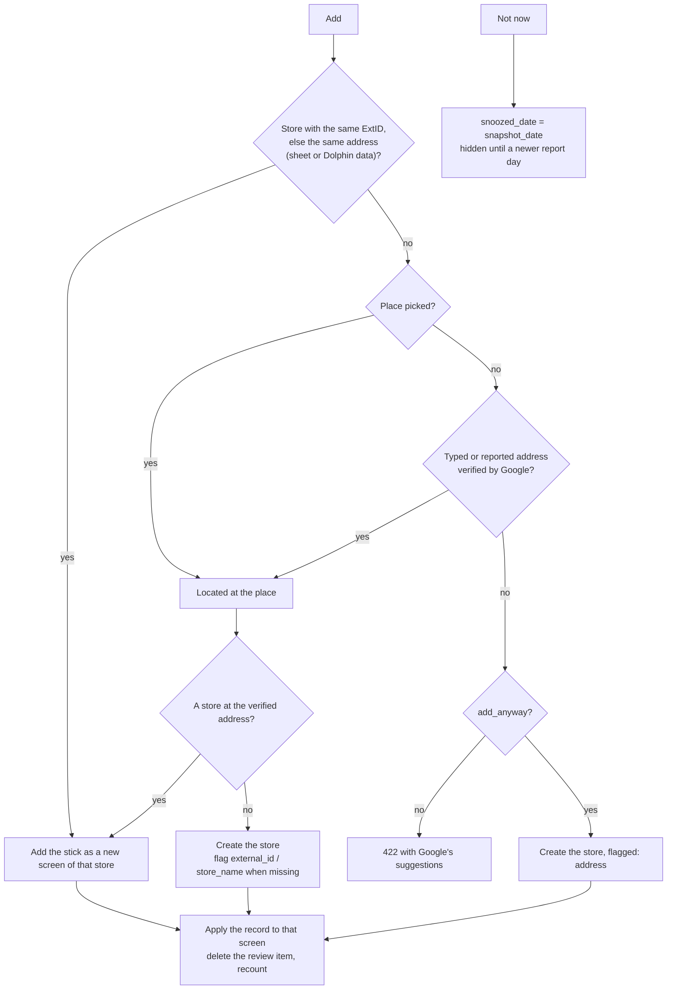
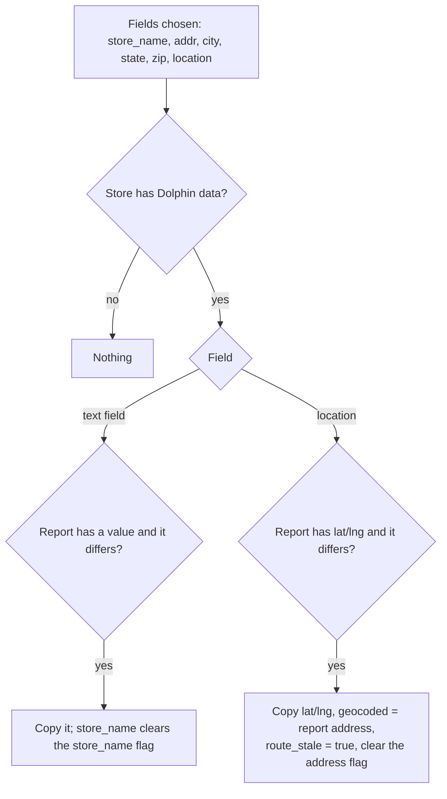
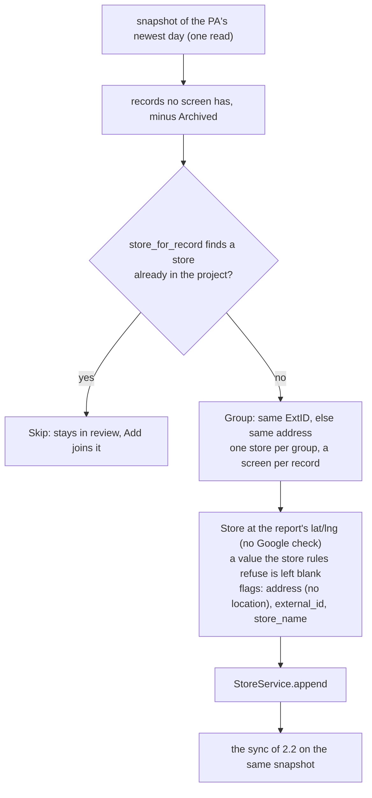

# Device sync and review: architecture, decision flows, review findings

Covers the "dolphin status sync" feature: `domain/device.py`, `domain/device_sync.py`, `services/device_sync.py`,
`repositories/device_data.py`, `repositories/device_review.py`, `handlers/device_data.py`, the worker's daily task,
`api/routers/device_sync.py`, the infra for it, and `frontend/src/features/device/*`.

Reviewed 2026-11-16 at commit `ec7a6b8`. Findings marked **confirmed** were reproduced against the in-memory
repositories; the rest come from reading the code.

## 1. Architecture

Code layers (all three entry points run the same `DeviceSyncService`):

What is stored where (all under `PK = PROJECT#<id>`):

| Item | Written by the sync | Notes |
| --- | --- | --- |
| `META` · `device_pa` | Settings | "" = no sync |
| `META` · `device_sync` | sync, `_recount` | pa, snapshot_date, ingested_at, synced_at, counters |
| `STOP#` · `screens[].device`, `screens[].status`, `status_changed_at` | sync, add | per-screen overlay and work status |
| `STOP#` · `device` | sync, add | store overlay from the first matched screen |
| `STOP#` · `needs_attention` | sync, ignore, overwrite | `not_reporting`, `dd_code_review` |
| `STOP#` · `device_alert_ignored` | ignore | the report day the alert was ignored for |
| `STOP#` · `dma`, `venue_type` | sync | only when blank |
| `DEVREVIEW#<venue key>` | sync (replace), snooze, add (delete) | one item per unknown venue |

## 2. Decision flows

### 2.1 When a sync runs

### 2.2 What one sync does

### 2.3 Per screen: overlay and work status

A packed entry ("DD-A. DD-B") matches nothing: the store gets `dd_code_review`, and its codes are kept out of the
review list.

### 2.4 Per store: "not in Dolphin data" alert

### 2.5 Review: Add and Not now

### 2.6 Overwrite

### 2.7 A project from the Dolphin data alone (no sheet)

Added 2026-11-24. New project → "Stores from: Dolphin data only" sends `POST /projects` with `device_pa` and no
stops (the project's `pa` defaults to it), then `POST /projects/{id}/device-sync/populate`. Settings → "Add stores
from Dolphin data" calls the same endpoint again, to retry or to take in new venues.

## 3. Findings

### Bugs

1. **A sync during the CMS's nightly load wipes the overlay and sticks for the day. (confirmed; accepted
   2026-11-16: "Sync now" repairs it, no change planned)**
   `MongoDeviceData._newest_raw_date` takes the newest `Date` across every PA
   (`repositories/device_data.py:58`), and `snapshot` reads the PA's rows for that day. If the new day exists but this
   PA's rows are not loaded yet (or only partly), the sync sees zero or few records: every screen loses `device`,
   every Completed store is flagged `not_reporting`, the review list is emptied. `state.snapshot_date` is then the
   new day, so `only_if_stale` (`services/device_sync.py:102`) skips every later attempt that day, including the
   12:00 UTC schedule. Only "Sync now" repairs it. The on-open sync can fire at any hour.
   Whether the load is atomic is not visible from this repo; if it is not, this will happen.
   Fix: have the staleness check also compare `ingested_at` (a finished load has a newer one), and refuse to apply a
   snapshot with zero records when the last sync matched some.

2. **Fixed 2026-11-16.** **Overwrite of store name + location together leaves the `store_name` flag. (confirmed)**
   In `overwrite_changes` (`domain/device_sync.py:158`) the `location` branch rebuilds `needs_attention` from
   `stop.needs_attention`, discarding what the `store_name` branch just removed. The frontend sends the fields in
   that order. Fix: start from `changes.get("needs_attention", ...)` like the other branch.

3. **Fixed 2026-11-16** (Add returns the store that already has the code; typing a code another store has is
   refused). **Add from review can put one DD code in two stores. (confirmed)**
   The review list is only rebuilt by a sync. If someone types the code into a store by hand, the item stays listed
   (and counted), and Add then attaches the same code to whatever store matches by ExtID or address
   (`services/device_sync.py:193`). Fix: in `add_from_review`, check the code against all screens first; if a store
   already has it, delete the item and return that store.

4. **Changing a screen's DD code keeps the old venue's device data. (confirmed)**
   `StoreService.update_screens` carries `device` over by screen id (`services/stores.py:537`), not by code. The
   screen shows the previous venue's status, serial and last-seen until the next report day, since the on-open sync
   is skipped as not stale. Fix: drop `device` when `venue_code_key` changed.

5. **Turning the sync off (or it never running again) leaves everything in place. (confirmed)**
   `ProjectService.update` clears only `META.device_sync` (`services/projects.py:170`). Stores keep `device`, screens
   keep `device`, `not_reporting` flags stay, `DEVREVIEW#` items stay, and the map and table keep showing the report's
   name and location with no way to remove them. Fix: clear the overlays and review items when `device_pa` becomes "".

6. **Sync bookkeeping bumps the project's `version`. (confirmed)**
   `ProjectRepository.update` increments `version` on every call (`repositories/projects.py:97`). Each sync, snooze,
   add and ignore does so, and so does the daily schedule. A Settings form opened before that saves with a stale
   `expected_version` and gets "modified concurrently" for an edit that did not conflict. It also moves `updated_at`,
   which `begin_routing` uses to detect a stale build. Fix: write `device_sync` with its own update that leaves
   `version` and `updated_at` alone.

7. **Review dialog can strand on an empty page.** `ReviewDialog.tsx:19` keeps a stack of offset cursors. Add or
   snooze the last item of the last page and the page comes back empty; when the total is now ≤ 25 the pager is
   hidden (`:122`), so there is no way back, and the state survives closing the dialog. Fix: reset to the first page
   when the page is empty and on close.

8. **Timeouts do not line up.** `sync` makes two Lambda invokes (`latest_date`, then `snapshot`), and `snapshot`
   repeats the `distinct("Date")`: up to three 20 s Mongo queries against a 25 s Lambda and a 29 s API
   (`infra/stacks/api_stack.py:100`). The comment there ("a slow Mongo fails the call cleanly") holds for one query
   only; otherwise the browser gets API Gateway's bare 503. Fix: one invoke, see simplification 1.

### Inconsistencies

9. **A manual status newer than the report is respected by the alert but not by the status rule.** `not_reporting`
   skips a screen changed after `ingested_at`; `sync_screen` (`domain/device_sync.py:71`) does not look at
   `status_changed_at`, so a screen someone set by hand this morning goes back to the report's status on the next
   sync. Decide which rule is intended and apply it in both places.

10. **`sync_all` reports skipped projects as synced. (confirmed)** `services/device_sync.py:143` counts every call
    that did not raise. Use the result's `synced`.

11. **Stored counters drift.** `review_count` and `not_reporting` on `META` are only recomputed by sync, snooze, add
    and ignore. A manual screen edit, a store delete or finding 3 leaves the header badge wrong until the next sync.

12. **`DEVICE_FIELDS` is described as "written only by the device sync"** (`domain/models.py:317`), but `screens`,
    `status`, `needs_attention`, `dma` and `venue_type` are also written by the store edits. The sync writes whole
    values computed from an earlier `list_all` with no condition, so an edit landing in between is overwritten. The
    window is short (the Mongo read happens first), but the "disjoint write groups" comment is not true here.

13. **PA names are trimmed for the list but matched exactly.** `list_pas` strips whitespace
    (`repositories/device_data.py:80`); `snapshot` queries `"PA Name": pa` verbatim. A name stored with stray
    whitespace would be offered and then match nothing.

14. **Timestamps are compared as text.** `status_changed_at < ingested_at` and `max(ingested_at_utc)` assume one
    ISO shape. `utc_iso` passes strings through unchanged, and the tests already cover a text `Last Seen`; a text
    `ingested_at_utc` would compare wrongly on the load day.

15. **Small ones.** The dialog says "Add creates the store" though it may join one. The sync schedule comment says
    the load is at about 03:00 UTC while the rule is at 12:00 (fine, but the nine hours are what finding 1 relies on
    for the schedule only). `Screen.status_changed_at`'s comment says "after the report's day"; the code compares
    with the load time.

### Risks to keep in mind

- A snapshot comes back through a synchronous Lambda invoke, capped at 6 MB. At roughly 600 bytes a record that is
  about 10,000 venues in one PA.
- One future-dated or mistyped `Date` in the report becomes "the newest day" for every project.

## 4. Simplifications

1. **One device-data call per sync.** Let `snapshot` take the date the caller already has and answer "not newer"
   without reading rows. Removes `latest_date`, one invoke and one `distinct` per sync, and fixes finding 8. Carry
   `ingested_at` in the same answer for finding 1.
2. **Derive the counters instead of storing them** (or recount inside the two writes that change them). Removes
   `_recount`, its extra `reviews.list` + `list_projected` on every snooze, add and ignore, and finding 11.
3. **`add_record_changes` has an unused `snapshot` parameter**; `add_from_review` builds a `DeviceSnapshot` only to
   pass it (`services/device_sync.py:215`). Drop both.
4. **`update_routing_many`, `update_progress_many` and `update_device_many` have the same body**
   (`repositories/stores.py:257`). One `_write_many(check, changes)`.
5. **`sync_stop` scans the screens three times** for the first matched record, the first DMA and the first venue
   type. Build the matched records once.
6. **Overwrite field names are validated three times**: the request model's `Literal`, the service's set check and
   the domain's `ValueError`. Keep the request model and one guard.
7. **`_create_store` re-reads every store to find the one it just appended**, the third full read in one Add. Have
   `append` return the new stops.
8. **`sync` reads the review list twice** (once for the snoozed keys, once inside `replace`). Let `replace` take the
   current items, or return them.
9. **The worker wires `DeviceSyncService` by hand** (`handlers/worker.py:71`) apart from `deps.py`. One factory used
   by both.
10. **Frontend: the status dot is implemented twice** (`ScreenDeviceLine` in `DeviceBits.tsx`, `DolphinCell` in
    `ScreensEditor.tsx`), and `splitCodes` duplicates the server's `split_codes` with no shared test cases.
